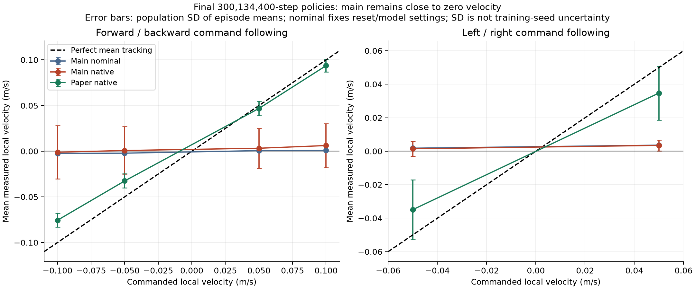
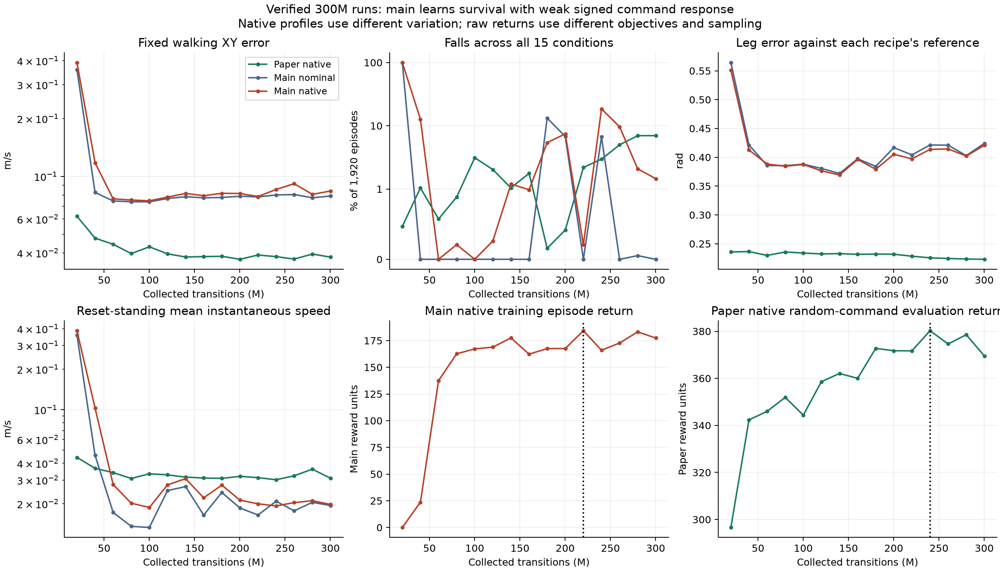
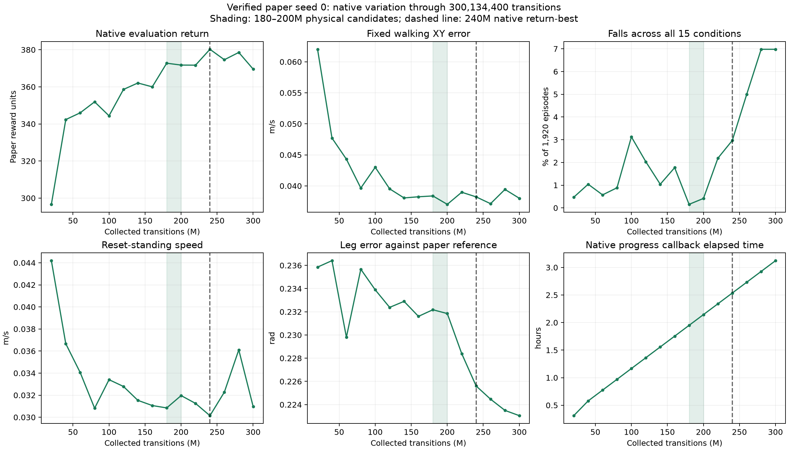
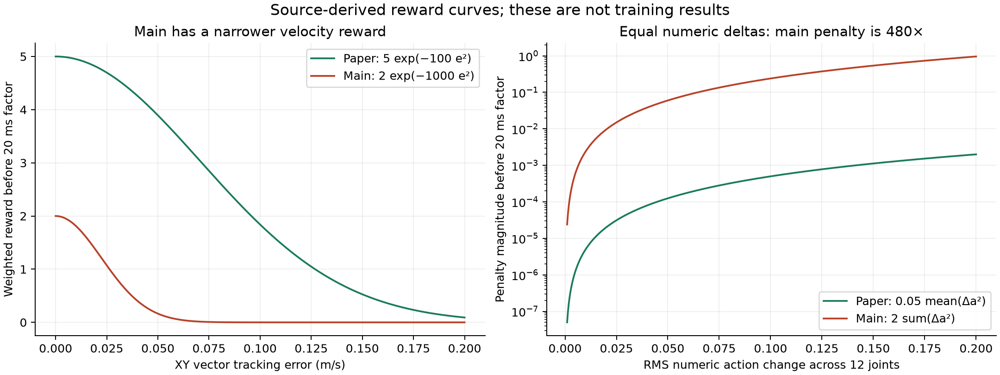
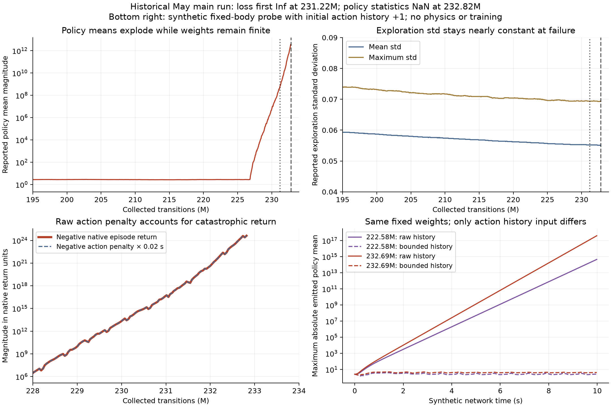

# Main versus paper walking results — 2026-10-17

## Analysis status

**The completed main and paper 300M runs are now available and verified.**
Main's transferred full run is `toddlerbot_2xc_walk_brax_20261016_191310`;
`182237` is a 40-step GPU smoke run. The historical May archive is a separate
1B-step experiment.

The strongest findings are:

- Main finishes with finite metrics and policies, but **weak velocity-command
  tracking**. Final fixed-command XY error is 0.083954 m/s in its native profile
  and 0.079021 m/s nominally, compared with paper's native 0.037999 m/s.
- For equal numeric action changes across 12 leg joints, main's action-change
  penalty is **480 times larger** than paper's. Main also has a much narrower
  XY velocity reward and no active leg-reference imitation reward. These are
  source-backed candidate causes; individual effects need controlled ablations.
- The historical main run develops enormous policy means, then infinite value
  loss and NaN weights. A controlled synthetic probe reproduces action-history
  amplification with saved, finite policy weights. Bounding only the history
  input prevents that amplification in the probe. This numerical failure is
  absent from the completed fresh 300M main run.
- Paper remains numerically finite through 300M. Its tracking improves mainly
  before 80M, while falls increase after 200M despite better leg imitation.
  The cause of that late survival regression has not been isolated.

The prepared comparison training code is `main-walking-compare` commit
`990b8b0`, based on `main` at `f81679b`. The experiment is documented in
[MAIN_WALKING_COMPARE.md](MAIN_WALKING_COMPARE.md).
The actual GPU run records HEAD **`a8637a1`**. The later local trainer/dependency
helper changes concern startup validation. Its reward/environment/evaluator
source, effective settings and PPO call match the prepared comparison.

Local data inspected:

| Dataset | Location | Use in this report |
| --- | --- | --- |
| Completed paper GPU run | `results/toddlerbot_walk_ppo_20261015_194347/` | Verified 300,134,400-transition baseline |
| Main CPU smoke run | `.worktrees/main-walking-compare/results/toddlerbot_2xc_walk_brax_20261016_113551/` | 40 transitions; execution check only |
| Historical main archive | `results/toddlerbot_2xc_walk_brax_20260515_114507/` | Previous 1B-transition experiment; 100 policy exports; numerical failure analyzed below |
| Main GPU smoke run | `results/toddlerbot_2xc_walk_brax_20261016_182237/` | 40 transitions; execution check only |
| Completed main GPU run | `results/toddlerbot_2xc_walk_brax_20261016_191310/` | Verified 300,134,400-transition comparison |
| Local W&B records | `wandb/offline-run-20261015_194347-h1vcwang/` | Paper run; no new main W&B run located |

The new main results below come directly from the transferred full run. Its
missing W&B offline directory limits independent exit-status/GPU-utilization
analysis; core progress, walking measurements and policy artifacts are complete.

## Transferred main run verification

The [main audit](docs/main_paper_walking_20261017/main_run_audit.json) confirms:

- Fresh seed 0, native Brax PPO, empty restore path, 300M requested and
  **300,134,400 actual transitions**. Effective settings match `main_compare.gin`.
- **16 retained checkpoints**, initialization plus 15 trained boundaries. All
  SHA-256 values match the manifest and every loaded parameter is finite.
- `model_best` matches **220,098,560**; `model_last` matches **300,134,400**.
- **30 finite metric records**: one episode-window callback and one epoch
  training callback per trained boundary. Duplicate step numbers reflect these
  two metric sources, rather than duplicate transfers.
- **32 evaluation suites**: nominal and native at all 16 checkpoints;
  **480 conditions / 61,440 episode-condition evaluations**, zero nonfinite.
- Per-episode means, population standard deviations, fall counts, lengths and
  group sample counts reconstruct; maximum summary difference is **8.32e-8**.
  Scheduled group counts also reconstruct from episode length and transition time.
- All **72 archived source hashes** match provenance, and all **28 model/reference
  hashes** match the current local files. The two differing local source files
  are the startup validation changes described above.
- Recorded GPU: **RTX 5070, compute capability 12.0**; Python 3.11.14,
  Brax 0.14.2, JAX/JAXlib 0.6.2, MuJoCo/MJX 3.3.4.

## Measured final comparison

All rows use the final **300,134,400-step** policy, ten fixed moving conditions,
one standing condition and four transition conditions, 128 episodes each.
Native variation differs between recipes, so these are descriptive results
under the named profiles, rather than a common robustness experiment.

| Measurement | Paper native | Main nominal | Main native |
| --- | ---: | ---: | ---: |
| Fixed-command XY error (m/s) | **0.037999** | 0.079021 | 0.083954 |
| Fixed falls / 1,280 | 84 | 0 | 23 |
| Standing speed (m/s) | 0.030955 | **0.019400** | 0.019769 |
| Standing falls / 128 | 6 | 0 | 0 |
| Transition falls / 512 | 44 | 0 | 5 |
| All falls / 1,920 | 134 (6.979%) | 0 | 28 (1.458%) |
| Mean episode length (steps) | 970.13 | 1,000.00 | 987.70 |
| Fixed leg motor RMSE, own reference (rad) | 0.223045 | 0.424139 | 0.420792 |
| Nonfinite episode evaluations | 0 | 0 | 0 |

Main's native fixed-command error is **2.21 times** paper's. Main also undertracks
without its native perturbations, so evaluation variation alone cannot explain
its weak response. Different training variation, geometry, reference and
runtime remain possible contributors.

For an analytic policy with identically zero local XY velocity, mean error over
these ten fixed commands would be **0.071623 m/s**. Both final main profiles are
worse than that baseline, and none of their 15 trained checkpoints beats it.
This is an analytic comparison, not a simulated standing-policy measurement.



The [PDF](docs/main_paper_walking_20261017/main_paper_signed_response.pdf) and
[complete final-condition CSV](docs/main_paper_walking_20261017/main_paper_final_conditions.csv)
retain both velocity components, vector error, speed, leg RMSE, population SD,
falls, lengths and eligible counts for all conditions/groups.

Mean measured velocity on the commanded axis:

| Command (m/s) | Paper native | Main nominal | Main native |
| --- | ---: | ---: | ---: |
| Forward X +0.10 | +0.093669 | +0.000835 | +0.006191 |
| Backward X −0.10 | −0.075575 | −0.002356 | −0.001106 |
| Right Y −0.05 | −0.034911 | +0.001800 | +0.001440 |
| Left Y +0.05 | +0.034733 | +0.003612 | +0.003468 |

The forward/backward velocity difference divided by the 0.20 m/s command span
is **84.6% for paper**, **1.6% for main nominal** and **3.6% for main native**.
The corresponding lateral response ratios are **69.6%, 1.8% and 2.0%**. These
describe the measured endpoint response; they are not uncertainty estimates
or evidence that one isolated configuration change caused the gap.

Lower standing speed and fewer falls do not establish successful commanded
walking. Main scarcely translates along the requested axes. The existing paper
native suite includes pushes, while main's profiles do not; a shared nominal
and robustness re-evaluation is needed for a controlled survival comparison.
Leg RMSE uses each recipe's own reference, not one shared motor trajectory.

## Main and paper training progress



The [PDF](docs/main_paper_walking_20261017/main_paper_progress.pdf),
[matched physical progress CSV](docs/main_paper_walking_20261017/main_paper_matched_progress.csv)
and [main native training CSV](docs/main_paper_walking_20261017/main_training_progress.csv)
retain all trained checkpoints. The bottom return panels have different reward
definitions and sampling sources; compare progress within each panel.

| Actual steps (M) | Main training return | Nominal XY error (m/s) | Native XY error (m/s) | Nominal falls / 1,920 | Native falls / 1,920 | Native leg RMSE (rad) |
| --- | ---: | ---: | ---: | ---: | ---: | ---: |
| 20.009 | 0.022 | 0.359273 | 0.391617 | 1,920 | 1,920 | 0.550888 |
| 80.036 | 162.610 | 0.073792 | 0.075357 | 0 | 4 | 0.384459 |
| 180.081 | 167.456 | 0.077670 | 0.081665 | 254 | 104 | 0.379262 |
| 200.090 | 167.531 | 0.078845 | 0.081486 | 130 | 143 | 0.405184 |
| **220.099 — return-best** | **184.216** | 0.078230 | 0.078578 | 0 | 4 | 0.397297 |
| 240.108 | 165.909 | 0.080049 | 0.085582 | 128 | 355 | 0.413762 |
| 280.125 | 183.127 | 0.077440 | 0.080638 | 1 | 40 | 0.402188 |
| 300.134 | 177.361 | 0.079021 | 0.083954 | 0 | 28 | 0.420792 |

Main destabilizes early at 20M, then improves survival sharply by 60–80M.
Fixed-command error settles near 0.074–0.086 m/s, while its own-reference leg
error remains above the initial nominal 0.235135 rad. The 220M return-best has
low falls, but still weak tracking. Later checkpoints do not resolve that gap.
Early terminated episodes and empty transition walking groups must retain
their eligibility counts; missing groups are not assigned zero error.

Main's final native training return is **177.361**, episode length **933.38**,
epoch value loss **0.010139** and total loss **0.027967**, all finite. Median
epoch throughput after the first stage is **44,624.7 transitions/s**; the
native cumulative training timer is **7,006.453 s**, and the final epoch
callback is at **10,396.557 s**. Paper's corresponding recorded training timer
is 8,892.766 s, with median throughput about 34,400 transitions/s. Different
robot/physics/learner implementations and callback/evaluation timing prevent
attributing runtime differences to one change. Full W&B timing is unavailable
for main.

## What the new results support about the cause

**The fresh main gap is weak command tracking, with finite optimization.** The
May run's raw-history amplification mechanism remains a documented numerical
risk, but it is not an observed failure of this 300M result.

The measured behavior is consistent with the changed reward balance. Main's
final native episode return decomposes approximately as follows:

| Reward contribution | Mean contribution to native episode return |
| --- | ---: |
| Foot phase/height | **+123.242** |
| Yaw velocity tracking | +23.778 |
| Torso orientation | +22.289 |
| Alive | +18.668 |
| XY velocity tracking | **+9.880** |
| Home-pose penalty | −11.066 |
| Action-change penalty | −3.730 |
| Foot orientation and roll/pitch-rate penalties | −5.698 |

These contributions sum to 177.361 within native float32 accumulation precision.
Foot height supplies about **12.5 times** the XY contribution. This is a
random-command training window, including standing and turning, so it does
not directly quantify reward under each fixed walking condition.

The narrow velocity kernel, strong action smoothing and absent direct leg
imitation provide plausible routes to a policy that earns posture/foot rewards
with little commanded translation. The home-pose term adds static joint
pressure, but its aggregate penalty is smaller than the foot-height reward;
the data do not isolate it as the sole cause. Robot/reference changes, policy
architecture and the lower learning rate are additional contributors to test.
The controlled comparisons below specify how to separate their effects.

## Paper reference candidates

**Retain paper 180M for survival and 200M for tracking.** Native return selects
240M, while the final 300M policy has substantially more falls. These rankings
come from the existing native-variation evaluation seed and need confirmation
on fresh evaluation draws before selecting a deployment policy.

| Paper checkpoint | Native evaluation return | Fixed walking XY error (m/s) | Fixed falls / 1,280 | Standing falls / 128 | Transition falls / 512 | All falls / 1,920 |
| --- | ---: | ---: | ---: | ---: | ---: | ---: |
| 180,080,640 — survival candidate | 372.745 | 0.038379 | 2 | 0 | 1 | **3 (0.156%)** |
| 200,089,600 — tracking candidate | 371.733 | **0.037025** | 5 | 0 | 3 | **8 (0.417%)** |
| 240,107,520 — native return-best | **380.249** | 0.038228 | 39 | 2 | 16 | 57 (2.969%) |
| 300,134,400 — final | 369.533 | 0.037999 | 84 | 6 | 44 | **134 (6.979%)** |

At the final paper checkpoint, reset-standing speed is **0.030955 m/s** and
fixed-command leg motor RMSE is **0.223045 rad**. The latter is error against
the paper implementation's own ZMP motor reference.

## Paper training progress



The green interval marks the 180–200M candidates; the dashed line marks the
240M native return-best. The [PDF](docs/main_paper_walking_20261017/paper_progress.pdf)
and [full progress CSV](docs/main_paper_walking_20261017/paper_progress.csv) retain
the plotted measurements, elapsed time and optimizer losses.

Fixed-command error and leg RMSE are equal means across ten moving conditions.
Standing is separate; the four transition conditions mix walking and standing.
Native return comes from the paper's separate stochastic random-command evaluator.

| Collected steps (M) | Native return | Fixed XY error (m/s) | Fixed falls | Standing speed (m/s) | Standing falls | Transition falls | Fixed leg RMSE (rad) |
| --- | ---: | ---: | ---: | ---: | ---: | ---: | ---: |
| 20.009 | 296.612 | 0.062016 | 6 | 0.044195 | 0 | 3 | 0.235851 |
| 40.018 | 342.340 | 0.047711 | 13 | 0.036662 | 2 | 5 | 0.236410 |
| 60.027 | 345.986 | 0.044307 | 7 | 0.034053 | 0 | 4 | 0.229813 |
| 80.036 | 351.904 | 0.039653 | 11 | 0.030820 | 0 | 6 | 0.235668 |
| 100.045 | 344.376 | 0.043000 | 38 | 0.033406 | 4 | 18 | 0.233893 |
| 120.054 | 358.583 | 0.039524 | 30 | 0.032792 | 0 | 9 | 0.232381 |
| 140.063 | 362.073 | 0.038058 | 15 | 0.031532 | 0 | 5 | 0.232898 |
| 160.072 | 360.000 | 0.038245 | 25 | 0.031062 | 1 | 8 | 0.231607 |
| 180.081 | 372.745 | 0.038379 | 2 | 0.030846 | 0 | 1 | 0.232178 |
| 200.090 | 371.733 | 0.037025 | 5 | 0.031964 | 0 | 3 | 0.231847 |
| 220.099 | 371.688 | 0.038976 | 31 | 0.031256 | 2 | 9 | 0.228396 |
| 240.108 | 380.249 | 0.038228 | 39 | 0.030143 | 2 | 16 | 0.225606 |
| 260.116 | 374.612 | 0.037131 | 66 | 0.032279 | 9 | 21 | 0.224469 |
| 280.125 | 378.557 | 0.039430 | 82 | 0.036108 | 15 | 37 | 0.223500 |
| 300.134 | 369.533 | 0.037999 | 84 | 0.030955 | 6 | 44 | 0.223045 |

Tracking improves mainly by 80M, then stays near 0.037–0.043 m/s. From the
180M checkpoint to the final policy, falls rise from 3 to 134 across the suite,
while leg imitation error improves. Native return therefore gives a different
checkpoint ranking from physical tracking and survival measurements.

The final recorded progress callback is at **11,243.460 seconds**, before the
last quantitative suite and cleanup. The native cumulative training timer is
**8,892.766 seconds**; the median training throughput after the first stage is
approximately **34,400 transitions/s**. These timers include different work and
should retain their native definitions when comparing main's runtime.

## Verification performed for this report

The [audit](docs/main_paper_walking_20261017/paper_audit.json) records input SHA-256
hashes and the checks run directly against the copied paper artifacts:

- Training metrics and evaluation step lists match: 15 checkpoints through
  300,134,400 actual transitions, fresh training seed 0.
- All native scalar metrics are finite. The 225 condition summaries cover
  28,800 episode-condition evaluations, with zero nonfinite episodes.
- Fall counts, mean episode lengths, group sample counts, eligible episode
  counts, episode-first means and population standard deviations reconstruct
  from the per-episode arrays to within 1e-6.
- The archived source revision is `1982ef3bf540fd5280bfe89937b57866f94de8de`.
  Provenance retains its recorded dirty-source flag.

The earlier paper report and detailed source/checkpoint audit are retained on
`paper-walking-baseline` as `PAPER_WALKING_RESULTS.md` and
`docs/paper_walking_20261016/audit.json`. This report's newly computed baseline
uses the raw JSON files present in this checkout.

## Training setup comparison

The main settings below are confirmed against the full GPU run's saved config,
provenance and source snapshots:

| Setting | Paper GPU run | Main GPU run |
| --- | --- | --- |
| Budget and seed | 300M requested / seed 0 | Same |
| Collection and updates | 1,024 envs; rollout 20; batch 256; 4 minibatches; 4 passes | Same |
| Actor and critic hidden sizes | 512 / 256 / 128 | Same |
| PPO coefficients | Discount 0.97; GAE 0.95; clip 0.2; entropy 0.0005 | Same |
| Normalization | Observation normalization disabled; advantage normalization enabled | Same |
| Robot | Published-era `toddlerbot` | `toddlerbot_2xc` |
| Runtime | Python 3.10; pinned Brax fork 0.10.5; JAX 0.6.2 | Python 3.11; Brax 0.14.2; JAX 0.6.2 |
| Physics | MuJoCo/MJX 3.2.4; 4 ms × 5 | MuJoCo/MJX 3.3.4; 5 ms × 4 |
| Policy | Swish; state-dependent Normal followed by tanh | ELU; Normal with independent learned log std |
| Action range | Tanh bounds the policy output; scale 0.25 rad | Raw policy output unbounded; scale 0.25 rad; final motor target clipped to joint limits |
| Actor / critic input sizes | 1,245 / 1,890; 15 frames | 1,260 / 2,265; 15 frames |
| Learning rate | Approximately 1e-4 over this budget | Constant 3e-5 |
| Global gradient norm clip | No global norm clip in the pinned native learner | 1.0 |
| XY reward | Weight 5; tracking coefficient 100 | Weight 2; tracking coefficient 1,000 |
| Leg motor reference reward | Weight 5 | Weight 0; separate home-pose penalty 0.5 |
| Action-change penalty | Weight 0.05 × mean squared leg action change; second difference also active at 0.05 | Weight 2 × sum squared action change; no second-difference term |
| Foot objective | ZMP reference contact, air time, distance, slip and clearance terms | Phase-dependent foot height, weight 7.5; flat-foot penalty 5; close-foot penalty 10 |
| Native survival training | Fall penalty 10; height [0.20, 0.40] m | Alive reward 1; height [0.20, 1.0] m |
| Training command ranges | X [−0.10, +0.20], Y ±0.10 m/s; yaw ±0.50 rad/s | X ±0.10, Y ±0.05 m/s; yaw ±1.0 rad/s |
| Command mixture | Standing 20%; turning 30%; walking 50% | Standing 20%; turning 20%; walking 60% |
| Friction / actuator parameter variation | Friction [0.5, 2.0]; torque/speed parameters ±20% | Friction [0.4, 1.0]; torque/speed parameters ±10% |
| IMU and head variation | Published-era noise; pushes enabled | Colored quaternion/gyro noise and head-pose variation; pushes disabled |
| Logged native return | Independent random-command evaluation episodes | Collected training episodes; native Brax evaluations disabled |
| Quantitative profiles | Native variation including pushes | Nominal and main-native variation; pushes disabled |

The [setup audit](docs/main_paper_walking_20261017/setup_analysis.json) records
the effective configs and source hashes. Current main `walk.gin`,
`main_compare.gin`, `mjx_env.py`, `walk_env.py` and `walk_zmp_ref.py` match the
archived main CPU smoke provenance. Its environment config is unchanged by the
full-training overlay. Every environment config section also matches the May
archive. The fresh GPU run's separate audit confirms its actual effective
config and runtime, while preserving its recorded `a8637a1` source revision.

Paper's cosine decay counts **optimizer updates**, with a 50M-update decay
period. The 300M-transition budget performs 234,480 updates, so its learning
rate barely changes from 1e-4. Treating that schedule as decaying over 50M
environment transitions would give an incorrect setup comparison.

Main's actor observes a quaternion instead of paper's Euler angles; its critic
also receives additional context. Observation normalization is disabled in
**both** recipes. The historical failure cannot be explained by saying that
only main lacked observation normalization.

## Why the walking objectives can produce different behavior



These are analytic curves from the source, not measured training curves. A
[PDF](docs/main_paper_walking_20261017/reward_setup_comparison.pdf) is available.
All values below precede the common 20 ms reward multiplier.

### 1. Main supplies less velocity reward at moderate tracking errors

Both implementations compute local XY velocity in the full torso quaternion
frame and compare it with the motion reference velocity. For vector error
`e = ||v_xy − v_ref_xy||`, their weighted rewards are:

| XY error (m/s) | Paper: `5 exp(−100 e²)` | Main: `2 exp(−1000 e²)` | Paper / main |
| --- | ---: | ---: | ---: |
| 0.020 | 4.803947 | 1.340640 | 3.58 |
| 0.050 | 3.894004 | 0.164170 | 23.72 |
| 0.075 | 2.848914 | 0.007213 | 394.96 |
| 0.100 | 1.839397 | 0.00009080 | 20,257.71 |

The error where each exponential drops to `1/e` of its peak is 0.10 m/s for
paper and 0.03162 m/s for main. A main policy that stands or steps without
translating under a 0.10 m/s command therefore gets almost no direct XY reward.
Foot-height and posture objectives can remain rewarding in that situation.
Main's measured policy undertracks commands, making this velocity kernel a
concrete first ablation. Reward values alone do not prove PPO gradient strength
or isolate the kernel as the cause of the observed behavior.

Sources: `_reward_lin_vel_xy` in the [frozen paper environment](results/toddlerbot_walk_ppo_20261015_194347/locomotion/mjx_env.py)
and [main environment](toddlerbot/locomotion/mjx_env.py), with weights from the
saved paper config and [main walk config](toddlerbot/locomotion/walk.gin).

### 2. Main's action-change coefficient is 480 times stronger

Paper uses `−0.05 mean(Δa_leg²)`. Main uses `−2 sum(Δa²)` across the same
number of controlled leg actions, 12. For equal numeric differences:

`main / paper = (2 × 12) / 0.05 = 480`.

At RMS action change 0.10, the penalty magnitudes are **0.0005** for paper and
**0.24** for main. Action scaling is 0.25 rad in both, but action bounds and
history handling differ, so this coefficient ratio does not assert that two
real policies experience equal deltas.

Strong smoothing can suppress movement and exploration. It also makes large
raw actions expensive without placing a bound on them. Paper additionally
penalizes the second action difference at weight 0.05; the active main recipe
has no matching acceleration term.

For a controlled coefficient comparison using main's existing sum formula,
the weight matching paper's first-difference term is **0.05 / 12 =
0.0041666667**, rather than 0.05. This is an ablation proposal, not a change
made to the prepared training recipe.

Sources: paper `_reward_leg_action_rate` / `_reward_leg_action_acc`; main
`_reward_penalty_action_rate`. Both rewards are multiplied by 0.02 s after
weighting.

### 3. Main trains a different gait objective

Paper directly rewards leg motor imitation with
`−5 mean((q_motor − q_ZMP)²)`. Main's `motor_pos` reward has weight zero;
instead it penalizes deviation from the **home pose** with a weighted sum at
weight 0.5. Per-leg pose weights are `[0.01, 1, 5, 0.01, 5, 5]`, emphasizing
hip yaw and ankle roll/pitch relative to hip pitch and knee.

Main still computes the ZMP reference for phase, non-leg motor targets and
critic context. What is disabled is the direct leg-reference reward. A
home-pose target and a moving ZMP motor target impose different pressures.

Main also rewards phase-dependent foot height: the weighted peak is **7.5**
when standing and up to **15** during swing, versus a maximum XY reward of 2.
Foot-height matching can be successful without matching signed translation.
Its flat-foot and close-foot penalties further shape the gait. These changes
make stepping in place, more conservative joint motion, or a different gait
plausible outcomes. The fresh suite establishes weak translation, but does not
visually identify the foot-motion pattern.

Paper has additional active energy, torque, slip, collision, stand-still and
ground-alignment terms that are inactive in this main recipe. Reward weight
tables alone do not capture their different formulas and aggregation.

Sources: paper `_reward_leg_motor_pos`; main `_reward_motor_pos` and
`_reward_penalty_pose`; `_reward_feet_phase` / `_reward_penalty_feet_ori` in
[main walk environment](toddlerbot/locomotion/walk_env.py).

### 4. Survival, robot geometry and runtime also differ

Paper's weight-10 survival term is a **terminal event penalty**, giving a
direct −0.2 reward contribution on an early height-terminal step. Main's
weight-1 alive term gives +0.02 every control step. Falls also remove future
rewards. The weights therefore do not imply a simple tenfold difference in
survival pressure. Main's native upper height limit is 1.0 m, compared with
paper's 0.4 m; the quantitative benchmark imposes 0.4 m on both.

Main learns with a lower learning rate and a global gradient clip; paper uses
a different action distribution, activation and native learner version. Both
have the same collection geometry and principal PPO coefficients in the
prepared 300M comparison, but their algorithms are not byte-identical.

The nominal paper COM height previously measured in the paper audit is
0.297811 m; main's recorded nominal COM height is 0.282244 m. Their velocity
scales `sqrt(g h)` differ by about 2.7%. That normalization cannot account for
the different motor models, posture, references, servo behavior or physics
version. Command coverage, pushes and noise are additional confounders.

## What caused the historical main numerical failure

The May archive requested 1B transitions and reached **1,001,594,880** despite
invalid losses and policies. It contains **100 nonempty native exports**,
including initialization and the final checkpoint. It used 2,048 envs, batch
128 × 16 minibatches × 4 passes, seed 0 and learning rate 3e-5. This gives
twice as many optimizer updates per collected transition as the prepared
1,024-env comparison. It is not a matched 300M experiment.

All saved environment config sections match the prepared main environment.
The archive records a clean working tree on main but has no exact HEAD or
package provenance. The policy probe reinstantiates its saved ELU/Normal
architecture with pinned local Brax 0.14.2 / Flax 0.10.6. These facts support
analysis of its actual saved weights, while the exact historical runtime
remains unverified.

### Verified chronology

The [historical progress CSV](docs/main_paper_walking_20261017/historical_main_progress.csv)
contains 104 checkpoint/critical-event rows sampled from 24,453 console
updates. Scalar values retain the console's original rounding.

| Actual transitions | Native training return | Logged max policy mean | Mean exploration std | Value loss |
| --- | ---: | ---: | ---: | ---: |
| 202,342,400 | 227.02 | 1.5060 | 0.0583 | 0.0271 |
| 222,576,640 | 224.18 | 1.6242 | 0.0559 | 0.0311 |
| 229,990,400 | −1.956 × 10¹³ | 5.700 × 10⁶ | 0.0553 | 1.397 × 10²⁵ |
| **231,219,200** | −3.006 × 10¹⁷ | 7.133 × 10⁸ | 0.0552 | **First logged infinity** |
| 232,693,760 | −2.109 × 10²⁴ | 2.009 × 10¹² | 0.0551 | Infinity |
| **232,816,640** | Prior rollout statistics still finite | **First logged NaN** | **NaN** | NaN |
| **232,857,600** | **First logged NaN return** | NaN | NaN | NaN |
| 1,001,594,880 | NaN | NaN | NaN | NaN |

The reported maximum/minimum policy means are batch/update statistics. Their
growth is distinct from the exploration standard deviation, which stays near
0.055 until the failure. The console prints the learning rate as `0.0000`
because 3e-5 rounds to four decimals; it is not evidence of a zero learning rate.



The [PDF](docs/main_paper_walking_20261017/historical_main_diagnosis.pdf) retains
the figure. Dotted/ dashed vertical lines mark the first infinite loss and
first NaN policy statistics. Only finite pre-failure values are plotted.

### Failure mechanism supported by the code and saved policies

Main's native actor produces **unbounded Normal actions**. Final motor targets
are clipped to physical joint limits, but raw actions still enter:

1. The `last_act` observation history supplied back to the actor over 15 frames.
2. The summed squared action-change penalty at weight 2.

Consequently, bounded motor targets do not bound either the policy's history
inputs or its negative action penalty. An action-history feedback loop can
amplify the actor output even when its weights are finite. A global gradient
clip bounds update gradients, not those observation values or inference outputs.

At 232,693,760 transitions, all actor and value weights are finite; the largest
actor parameter magnitude is only **3.1194**. At 242,810,880 and in the final
export, actor and value parameter arrays contain NaNs. The running-statistics
tree also grows enormous before becoming invalid, but observation normalization
is disabled, so that tree is not used to normalize the actor input.

At four catastrophic updates from 229.99M to 232.69M,
`0.02 × logged action-change penalty` matches the negative native return to a
maximum relative gap of **2.34 × 10⁻⁷**. The finite bounded XY reward cannot
offset this raw-action penalty. Huge return/value targets followed by infinite
value loss and NaN policy statistics are the observed numerical failure path.

### Controlled network experiment

The [policy audit](docs/main_paper_walking_20261017/historical_policy_audit.json)
checks six saved checkpoints and records their file hashes. A CPU-only probe
then holds motor/IMU inputs at nominal home values, supplies a forward command
of 0.10 m/s and advances phase for 500 network steps (10 s). Initial action
history is +1 on every leg joint. It repeats this with the **same fixed weights
and inputs**, bounding only subsequent action-history inputs to [−1, +1].
The actor output remains unbounded in both variants; no learning occurs.

| Saved policy | Raw-history maximum absolute mean | Bounded-history maximum absolute mean |
| --- | ---: | ---: |
| 222,576,640 — before logged divergence | **4.617 × 10¹⁴** | **3.9476** |
| 232,693,760 — after infinite value loss | **4.022 × 10¹⁷** | **5.0439** |

The seven probe scenarios also include forward/backward/lateral/standing with
zero initial history and a negative initial history. Those scenarios do not
show the same amplification within this probe's 500 steps. The +1 experiment
demonstrates sensitivity to history, not failure under every initial state.

This provides a reproducible **causal intervention within the synthetic
network experiment**. It does not identify the real physics episode that
triggered divergence, prove that a particular reward weight created the
unstable policy, or validate history clipping as a production controller fix.
Motor and IMU feedback are held fixed; real rollouts can change the result.

Paper's tanh policy bounds the action signal supplied to its environment and
history, apart from its small bounded action noise. That limits this particular
raw-action amplification path. It does not explain paper's finite but growing
late fall rate.

The old run's full episode length/alive signal after NaNs is not proof of
survival: a height comparison with NaN returns false. The prepared main code
now rejects nonfinite metrics and policies at its progress/export checks, and
its quantitative evaluator counts nonfinite episodes separately. The fresh
run passes the metric/policy/measurement finiteness checks through 300M.

## Controlled comparisons to identify the walking-quality cause

The fresh main run has a measured tracking gap at the matched budgets. The
following one-factor experiments can distinguish the source-backed hypotheses.
Keep the main robot, physics/runtime, commands,
randomization, seed and collection geometry fixed; each change gets a fresh
run with the same checkpoint evaluations.

| Priority | Intervention | Question answered |
| --- | --- | --- |
| 1 | Check raw means/history, applied-target saturation and finite metrics; test a consistent bounded action/history design in a separate experiment | Does numerical action-history amplification occur, and can it be contained while preserving a feasible gait range? |
| 2 | Main XY weight 5 and tracking coefficient 100; other objectives fixed | Does a broader velocity reward improve signed command following? |
| 3 | Main summed action-change weight 0.0041666667; other objectives fixed | Does paper-strength first-difference smoothing improve motion/exploration? |
| 4 | Add negative-mean-square leg imitation at weight 5 using main's own reference; keep home-pose penalty fixed initially | Does explicit reference guidance improve imitation, tracking or falls? |
| 5 | With leg imitation held fixed, reduce or remove the home-pose term | Does the static home target conflict with the walking reference? |

Main's existing leg tracking function can produce negative MSE with
`RewardsConfig.use_exp_reward=False` and leg weight 1. Setting `motor_pos=5`
alone leaves its default exponential tracking formula and does not reproduce
paper's leg reward. Feasible action ranges must be checked against main's
reference and joint limits before changing bounds.

Use nominal evaluations on both robots and a separately specified common
robustness profile. Preserve each recipe's native variation measurements as
additional results. Select checkpoints using fresh evaluation draws; repeat
promising experiments over independent training seeds before assigning a
general cause. Paper's tracking plateau and late fall regression are observed
trends; correlation with improved imitation does not establish imitation as
their cause.

## How the physical results will be compared

Main's quantitative evaluator uses the shared [0.20, 0.40] m benchmark height
range and the same 15 signed conditions, 128 episodes per condition, 1,000-step
horizon, 20 ms control period and evaluation seed 12102. Automatic resets and
internal motion teleports are disabled during measurement. Verify these values
in the transferred suites before combining progress tables.

Compare physical tracking, standing, falls, episode length and leg imitation
at matched actual transition counts, especially approximately 180M, 200M, 240M
and 300M. Keep main's nominal and native profiles separate. The existing paper
data include its native pushes and other variation; a controlled nominal
comparison requires a nominal re-evaluation of the paper checkpoints.

XY error is the episode-first mean instantaneous vector error in the full torso
quaternion frame. Standing speed is mean instantaneous XY speed. Leg RMSE is
episode-first error against each implementation's own reference. Include falls,
nonfinite counts, eligible sample counts and episode lengths beside error, since
failed episodes have shorter measurement windows. Episode standard deviations
describe one training seed's evaluation draws, not training-seed uncertainty.
Main's nominal profile fixes model/reset settings. Small recorded variation
between nominal batch instances does not represent independent training seeds.

Raw native returns have different reward definitions and sampling sources; use
their curves to understand each run's progress. Different robots, references,
observations, action distributions, randomization and runtimes prevent attributing
any eventual performance difference to one reward or trainer change. Compare
geometry-normalized velocity and time using each measured nominal COM height.

The paper's Table II value of 0.016 m/s comes from its square-trajectory experiment.
That experiment's filtering and aggregation differ from the instantaneous vector
error measured here, so it is not an identical acceptance threshold for this suite.

## Remaining comparison limits

The core copied artifacts are complete. Main's W&B offline directory can add
independent exit-status and GPU timing/load records, but is not required for
the physical result analysis above.

Paper nominal re-evaluation and a shared robustness profile are still needed
to control evaluation variation. Independent training seeds, fresh evaluation
draws and the proposed ablations are needed to establish repeatability and
attribute the gap to a specific setup change. No ablation result is claimed.

## Reproducing this analysis

From this checkout, with the preserved CPU comparison environment and the
local archived run folders:

```sh
.venv-main-compare/bin/python docs/main_paper_walking_20261017/inspect_historical_main.py
.venv-main-compare/bin/python docs/main_paper_walking_20261017/analyze_setup.py
.venv-main-compare/bin/python docs/main_paper_walking_20261017/analyze_main_run.py
```

These scripts inspect saved weights, probe the actor without physics, parse
the historical console, verify transferred main artifacts and generate the
setup/run audits, CSV files and figures. The
compressed [probe traces](docs/main_paper_walking_20261017/historical_policy_probe_traces.npz)
retain all seven scenarios with both history variants. No training source or
training hyperparameters were changed for this analysis.

Reference: [ToddlerBot paper v2](https://arxiv.org/html/2502.00893v2).
