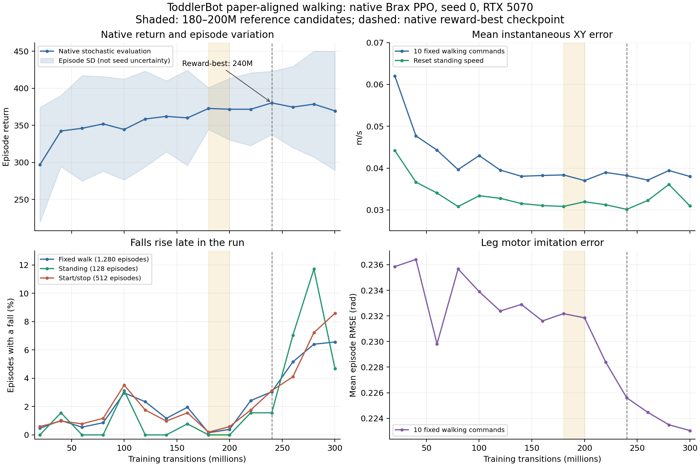

# ToddlerBot paper walking results — 2026-10-16

## Result and reference checkpoints

The GPU run **completed 300,134,400 fresh training transitions** using native Brax PPO, seed 0, and the published Table VI/VII settings. It produced 15 retained checkpoints and 15 complete signed-command evaluations. W&B records exit code 0.

**Use the 180M and 200M checkpoints as WR2 reference candidates.** The lowest fall count is at 180M; the lowest mean fixed-command tracking error is at 200M. Survival degrades later, although parameters remain finite and leg imitation error improves. Neither candidate establishes full walking qualification or reproduction of the paper's trajectory result.

| Checkpoint | Native return | Fixed walking vector error (m/s) | Fixed falls / 1,280 | Standing falls / 128 | Transition falls / 512 | All falls / 1,920 |
| --- | ---: | ---: | ---: | ---: | ---: | ---: |
| **180,080,640 — survival reference** | 372.745 | 0.03838 | 2 | 0 | 1 | **3 (0.156%)** |
| **200,089,600 — tracking reference** | 371.733 | **0.03702** | 5 | 0 | 3 | **8 (0.417%)** |
| 240,107,520 — native reward-best | **380.249** | 0.03823 | 39 | 2 | 16 | 57 (2.969%) |
| 300,134,400 — final | 369.533 | 0.03800 | 84 | 6 | 44 | **134 (6.979%)** |

The archive's `best_policy` is **240,107,520**, selected by native random-command episode return. Its `policy` is **300,134,400**. Both mappings were checked by SHA-256 against the retained exports. The recommendations above do not rename these files.

## Run identity and execution checks

| Item | Verified value |
| --- | --- |
| ToddlerBot run | `results/toddlerbot_walk_ppo_20261015_194347/` |
| W&B offline run | `offline-run-20261015_194347-h1vcwang` |
| W&B start, UTC | `2026-10-16T02:43:47.905750Z` |
| Branch / source revision | `paper-walking-baseline` / `1982ef3bf540fd5280bfe89937b57866f94de8de` |
| Published-era release base | `v1.0.0` / `59832cde2be3ab029486958f2e5ba92604f87307` |
| Brax fork | `14147806f6c25724ba830ba36764df3243889b0d`, package 0.10.5 |
| GPU | RTX 5070; compute capability 12.0; driver 580.178.04 reported by the GPU host |
| Environment | `.venv-paper-blackwell`; Python 3.10.19; JAX/JAXlib/CUDA plugin/PJRT 0.6.2 |
| Simulation | MuJoCo/MJX 3.2.4; NumPy 1.26.4 |
| Neural network / optimizer packages | Flax 0.10.6; Optax 0.2.5; Chex 0.1.90; Orbax 0.11.13 |
| GPU libraries | CUDA NVCC 12.9.86 / runtime 12.9.79; cuDNN 9.8.0.87 |
| Dependency lock | `requirements-paper-blackwell.lock`; SHA-256 `2de55a7e171b758485772f353e97e3b949bde5308677dd1dd6f22e65dc8dfdb3` |

This is a **paper-aligned published-era baseline with a Blackwell compatibility runtime**. The original JAX 0.4.28 runtime could enumerate this GPU but could not compile its kernels; the separate profile changes runtime packages while retaining the pinned Brax fork and published training recipe. The paper does not specify an identical source/runtime/initialization combination.

The run provenance records `source_dirty=true`. All **11 frozen locomotion source/config files** match the recorded commit byte for byte. All **12 recorded model/reference hashes**, including the original ZMP cache, match the local files; the copied and tracked dependency locks also match. Other source directories were not frozen, so the dirty flag is retained in the audit.

Checks against the copied artifacts:

- All 15 native metric rows are finite. All 15 checkpoint `finite.json` files report finite full parameters and metrics.
- Independently loading all 15 exported inference policies finds only finite parameter leaves. These exports contain the observation normalizer and actor; the full checkpoints also retain value parameters.
- Checkpoint, training-metric and XY-evaluation step lists match exactly, through 300,134,400.
- All **225 condition summaries / 28,800 episode-condition evaluations** have zero nonfinite episodes. Fall counts, group eligibility, sample counts, means and population standard deviations reconstruct from the per-episode data; maximum summary rounding difference is **3.83e-8**.
- Scanning the copied W&B binary succeeds; all 15 history steps and episode returns match `metrics.jsonl` exactly, and the recorded exit code is 0.

The prior GPU JIT preflight and 40-step PPO smoke check established execution. The full-run measurements below establish the observed performance under this evaluation protocol.

## Effective training recipe

The archived `train_config.json`, `env_config.json` and frozen `paper.gin` are the effective settings.

| Setting | Value |
| --- | --- |
| Budget / initialization | Fresh seed 0; requested 300M; actual 300,134,400 transitions |
| PPO collection and updates | 1,024 environments × 20 steps; 256 rollout sequences per minibatch; 4 minibatches; 4 passes |
| Total update counts | 14,655 rollout iterations; 234,480 minibatch optimizer updates |
| Episode / discount | 1,000 control steps; gamma 0.97 |
| Learning rate / entropy / clipping | 1e-4 / 5e-4 / 0.2 |
| Actor / critic | 512/256/128, native Swish; 83/126 values × 15 frames = 1,245/1,890 |
| Policy distribution / actions | State-dependent Normal followed by tanh; 12 leg motor targets, home + 0.25 rad × residual |
| Control / gait / solver | 20 ms control, 4 ms × 5 physics steps; 0.72 s gait; Newton, 1 iteration |
| Commands sampled in training | X [−0.10, +0.20], Y [−0.10, +0.10] m/s; yaw [−0.50, +0.50] rad/s; 20% zero commands |
| Variation | Native model/servo randomization, observation/action noise, reset yaw and periodic pushes enabled |
| Checkpoint interval / quantitative evaluation | 15 checkpoints approximately 20M transitions apart; 128 episodes per condition; video skipped |

All Table VII reward weights are explicit. This includes leg motor imitation **5**, linear XY tracking **5**, survival **10**, and feet clearance **0.05**; the release's `walk.gin` default clearance weight was 1.0. Reward definitions remain those of the published-era implementation.

The released cosine learning-rate schedule counts **optimizer updates**, with `decay_steps=50,000,000` and `alpha=0.1`. This run makes 234,480 optimizer updates, so its learning rate remains approximately 1e-4. The 50M setting is not a decay horizon in environment transitions.

## Metric definitions and evaluation protocol

The measurement source is the copied `results/` JSON data and W&B binary, rather than the W&B `logs/` directory alone. The frozen ToddlerBot evaluator and WR2 evaluator/metric implementations were inspected directly.

Each checkpoint receives **15 conditions × 128 episodes × 1,000 control steps**, or at most 20 seconds per episode: six cardinal commands, four diagonal commands, reset-standing, and four directional start/stop schedules. Policy inference is deterministic; configured noise, model/servo/reset variation and pushes remain active.

1. **Signed velocity:** torso linear velocity rotated by the inverse **full torso quaternion**, including roll and pitch. This is neither world-frame velocity nor a yaw-only heading projection.
2. **XY vector error:** mean over steps of `||v_xy − command_xy||` within each episode, followed by an equal average of eligible episodes. This differs from component MAE, RMSE, and `||mean(v_xy) − command_xy||`.
3. **Standing speed:** mean instantaneous `||v_xy||` under zero command. A mean signed velocity near zero can coexist with appreciable motion.
4. **Leg motor RMSE:** square root of the mean squared error over time and the 12 leg motors, then an equal average of episode RMSE values. Reference values come from the native ZMP motor-position reference. It is not one pooled RMSE over every sample.
5. **Fall:** a finite torso-height terminal event, below 0.20 m or above 0.40 m. The evaluator records nonfinite failures separately. Reaching the 1,000-step horizon is not a fall.
6. **Standard deviation:** population SD of episode means, not uncertainty across training seeds. Empty groups are omitted from the CSV; they do not receive zero error.

Measurements include the terminal finite sample, then stop at the first fall/nonfinite event. There are no resets inside a measured episode. Failed episodes contribute their shorter pre-failure measurements with the same episode weight, so error must be read alongside falls and length.

The same 128 model/reset draws are reused across ToddlerBot conditions and checkpoints, with base seed **12102**. These 28,800 evaluations are repeated measurements of one training seed, not independent training replications. Selecting 180M/200M on this set requires confirmation on new held-out draws before promotion.

Transition timing is **stand 0–3 s, walk 3–9 s, stand 9–12 s, walk 12–17 s, stand 17–20 s**. Start and stop groups cover the first **0.5 s** after each change. Overall transition error and velocity mix walking and standing; they must not be treated as pure walking tracking or divided by a constant walking command.

## Training progress



The shaded 180–200M interval marks the reference candidates; the dashed line marks native reward-best at 240M. The return band is episode SD. The [PDF](docs/paper_walking_20261016/training_progress.pdf) is available for export.

Fixed-command error and leg RMSE below are equal means across the ten moving endpoints. Standing is separate. Native return and episode length come from the native **stochastic, random-command evaluator**, rather than the deterministic suite.

| Steps (M) | Native return ± SD | Native mean length | Fixed XY error (m/s) | Fixed falls | Standing speed (m/s) | Standing falls | Transition falls | Fixed leg RMSE (rad) |
| --- | ---: | ---: | ---: | ---: | ---: | ---: | ---: | ---: |
| 20.009 | 296.61 ± 77.60 | 919.36 | 0.0620 | 6/1280 | 0.0442 | 0/128 | 3/512 | 0.2359 |
| 40.018 | 342.34 ± 48.06 | 984.90 | 0.0477 | 13/1280 | 0.0367 | 2/128 | 5/512 | 0.2364 |
| 60.027 | 345.99 ± 71.28 | 953.63 | 0.0443 | 7/1280 | 0.0341 | 0/128 | 4/512 | 0.2298 |
| 80.036 | 351.90 ± 63.90 | 957.99 | 0.0397 | 11/1280 | 0.0308 | 0/128 | 6/512 | 0.2357 |
| 100.045 | 344.38 ± 68.20 | 944.87 | 0.0430 | 38/1280 | 0.0334 | 4/128 | 18/512 | 0.2339 |
| 120.054 | 358.58 ± 64.58 | 961.90 | 0.0395 | 30/1280 | 0.0328 | 0/128 | 9/512 | 0.2324 |
| 140.063 | 362.07 ± 47.92 | 980.96 | 0.0381 | 15/1280 | 0.0315 | 0/128 | 5/512 | 0.2329 |
| 160.072 | 360.00 ± 64.37 | 964.81 | 0.0382 | 25/1280 | 0.0311 | 1/128 | 8/512 | 0.2316 |
| 180.081 | 372.74 ± 28.20 | 996.56 | 0.0384 | 2/1280 | 0.0308 | 0/128 | 1/512 | 0.2322 |
| 200.090 | 371.73 ± 41.62 | 989.29 | 0.0370 | 5/1280 | 0.0320 | 0/128 | 3/512 | 0.2318 |
| 220.099 | 371.69 ± 49.15 | 977.16 | 0.0390 | 31/1280 | 0.0313 | 2/128 | 9/512 | 0.2284 |
| 240.108 | 380.25 ± 42.76 | 982.24 | 0.0382 | 39/1280 | 0.0301 | 2/128 | 16/512 | 0.2256 |
| 260.116 | 374.61 ± 54.82 | 975.98 | 0.0371 | 66/1280 | 0.0323 | 9/128 | 21/512 | 0.2245 |
| 280.125 | 378.56 ± 71.55 | 955.71 | 0.0394 | 82/1280 | 0.0361 | 15/128 | 37/512 | 0.2235 |
| 300.134 | 369.53 ± 80.28 | 939.52 | 0.0380 | 84/1280 | 0.0310 | 6/128 | 44/512 | 0.2230 |

Tracking improves mainly during the first 80M transitions, then remains near 0.037–0.043 m/s. Native reward peaks at 240M. Fixed walking falls rise from **2 at 180M** to **39 at 240M** and **84 at 300M**. Transition falls rise from **1 to 16 to 44** at those checkpoints.

The 260M checkpoint has the lowest mixed transition error, approximately **0.03547 m/s**, but has 66 fixed-walking falls, 9 standing falls and 21 transition falls. That diluted metric alone would select a less reliable policy.

Leg imitation improves from **0.23585 to 0.22305 rad**, approximately **5.43%**, between 20M and 300M. This improvement does not establish improved survival. The prior reference audit found some native swing motor references **1.064 rad from home**, beyond the actor's ±0.25 rad target residual. Imitation is a soft reward, not exact replication of every reference target; the archive does not identify the cause of the late fall regression.

Selected native optimizer losses:

| Steps (M) | Policy loss | Value loss | Entropy loss | Total loss |
| --- | ---: | ---: | ---: | ---: |
| 20.009 | -0.008283 | 0.088372 | 0.003616 | 0.083705 |
| 180.081 | -0.005650 | 0.065691 | 0.012181 | 0.072222 |
| 200.090 | -0.006149 | 0.063959 | 0.012445 | 0.070254 |
| 240.108 | -0.008111 | 0.066494 | 0.012516 | 0.070899 |
| 300.134 | -0.007709 | 0.066994 | 0.013106 | 0.072391 |

These finite scalar losses establish numerical execution; they do not diagnose a cause for the falls. Entropy loss is the coefficient-weighted negative distribution entropy, so its sign alone is not a policy-collapse test.

## Final checkpoint: signed walking and standing

All rows have 128 episodes, zero nonfinite episodes, and a maximum length of 1,000 steps. Velocities and errors are m/s; leg RMSE is rad. ± values are episode SD.

| Condition | Walking command (X, Y) | Mean velocity (X, Y) | XY error ± SD | Leg RMSE | Falls | Mean length |
| --- | --- | --- | ---: | ---: | ---: | ---: |
| forward_010 | (+0.1000, +0.0000) | (+0.0937, -0.0020) | 0.0371 ± 0.0131 | 0.2221 | 7/128 | 971.39 |
| backward_010 | (-0.1000, +0.0000) | (-0.0756, -0.0026) | 0.0408 ± 0.0098 | 0.2296 | 5/128 | 981.67 |
| backward_005 | (-0.0500, +0.0000) | (-0.0326, +0.0002) | 0.0372 ± 0.0123 | 0.2228 | 10/128 | 965.16 |
| forward_005 | (+0.0500, +0.0000) | (+0.0468, -0.0006) | 0.0346 ± 0.0106 | 0.2192 | 8/128 | 967.48 |
| right_005 | (+0.0000, -0.0500) | (+0.0017, -0.0349) | 0.0381 ± 0.0131 | 0.2220 | 12/128 | 960.66 |
| left_005 | (+0.0000, +0.0500) | (+0.0031, +0.0347) | 0.0359 ± 0.0126 | 0.2199 | 6/128 | 979.80 |
| backward_right | (-0.0707, -0.0354) | (-0.0510, -0.0225) | 0.0411 ± 0.0163 | 0.2272 | 15/128 | 958.45 |
| backward_left | (-0.0707, +0.0354) | (-0.0515, +0.0220) | 0.0395 ± 0.0072 | 0.2264 | 4/128 | 987.70 |
| forward_right | (+0.0707, -0.0354) | (+0.0646, -0.0299) | 0.0414 ± 0.0223 | 0.2215 | 14/128 | 940.73 |
| forward_left | (+0.0707, +0.0354) | (+0.0666, +0.0249) | 0.0344 ± 0.0052 | 0.2197 | 3/128 | 994.88 |
| standing | (+0.0000, +0.0000) | (+0.0031, -0.0013) | 0.0310 ± 0.0072 | 0.0795 | 6/128 | 984.83 |
| forward_transitions | (+0.1000, +0.0000) | (+0.0531, -0.0017) | 0.0366 ± 0.0092 | 0.1733 | 8/128 | 973.30 |
| backward_transitions | (-0.1000, +0.0000) | (-0.0399, -0.0003) | 0.0401 ± 0.0126 | 0.1802 | 10/128 | 969.23 |
| right_transitions | (+0.0000, -0.0500) | (+0.0023, -0.0186) | 0.0380 ± 0.0157 | 0.1743 | 17/128 | 949.84 |
| left_transitions | (+0.0000, +0.0500) | (+0.0030, +0.0211) | 0.0355 ± 0.0151 | 0.1721 | 9/128 | 966.87 |

The final forward +0.10 m/s command averages **+0.0937 m/s**, while backward −0.10 averages **−0.0756 m/s**. Lateral ±0.05 commands average approximately **±0.0348 m/s**. Forward average speed is close to its command, but instantaneous vector error remains 0.0371 m/s and 7/128 episodes fall.

Reset-standing averages velocity **(+0.0031, −0.0013) m/s**, yet instantaneous speed is **0.0310 m/s**, with **6/128 falls**. This is incomplete standing control. The archived measurements do not include a standing displacement trace.

### Start and stop recovery at 300M

Cells show **mean vector error in m/s (eligible episodes)**. Under a zero command, standing/stop error is instantaneous speed.

| Transition direction | Standing portions | Walking portions | First 0.5 s after start | First 0.5 s after stop |
| --- | ---: | ---: | ---: | ---: |
| forward | 0.0361 (128) | 0.0372 (128) | 0.0546 (128) | 0.0601 (126) |
| backward | 0.0346 (128) | 0.0471 (128) | 0.0656 (128) | 0.0469 (124) |
| right | 0.0350 (128) | 0.0421 (128) | 0.0445 (128) | 0.0396 (124) |
| left | 0.0344 (128) | 0.0353 (127) | 0.0454 (127) | 0.0344 (125) |

Walking-only error is approximately 0.0353–0.0471 m/s; stop speed is approximately 0.0344–0.0601 m/s. Episodes that fall before a phase are ineligible for that phase. The CSV records the exact sample counts and SDs.

Even the 180M survival reference has reset-standing speed **0.03085 m/s**, backward walking-phase error **0.04602 m/s**, and backward start error **0.05934 m/s**. Low falls do not establish perfect standing or recovery.

## Comparing with ToddlerBot main

The inspected local `main` and `origin/main` both point to **`f81679b72cca2cb227e190beeea18eed7894c10c`**. This is a comparison with the current local branch snapshot; the remote was not refreshed during this audit. Source values below were read with `git show main:<path>` from `walk.gin`, `ppo_config.py`, `mjx_config.py`, `mjx_env.py`, `train_mjx.py` and `pyproject.toml`.

| Setting | Completed paper run | Main default walking implementation |
| --- | --- | --- |
| Robot | Published-era `toddlerbot` | `toddlerbot_2xc`; old `toddlerbot` description removed |
| Trainer | Pinned native Brax PPO | RSL-RL by default; `--brax` selects Brax |
| Training budget | 300M requested | 1B requested by `walk.gin` |
| Network / exploration | Swish; state-dependent Normal followed by tanh | ELU; independent learned log std, Normal |
| Learning rate | 1e-4 | 3e-5; adaptive schedule in RSL-RL |
| Actor / critic history | 1,245 / 1,890 | 1,260 / 2,265, with torso quaternion observations |
| XY reward | Weight 5; `exp(−100 e²)` | Weight 2; `exp(−1000 e²)` |
| Leg reference imitation | Negative mean square motor error, weight 5 | `motor_pos` weight 0; weighted home-pose penalty 0.5 |
| Survival | Height-terminal penalty, weight 10 | Alive reward 1; survival penalty weight 0 |
| Native height termination | [0.20, 0.40] m | [0.20, 1.0] m on flat walking terrain |
| Control / physics | 4 ms × 5 = 20 ms; MuJoCo/MJX 3.2.4 | 5 ms × 4 = 20 ms; project pins MuJoCo/MJX 3.3.4 |
| Training commands | X [−0.10, +0.20], Y [−0.10, +0.10] m/s; yaw ±0.50 rad/s | X ±0.10, Y ±0.05 m/s; yaw ±1.0 rad/s |
| Perturbation defaults | Native pushes enabled | `add_push=False`; `walk.gin` enables head-pose randomization |

### First experiment: main with a matched budget and benchmark

Use main's current walking rewards and observation/model implementation, select **`--brax`** for the first run, and keep the collected budget comparable: **fresh seed 0, 300M transitions, 1,024 environments, 20-step rollouts, batch 256 × 4 minibatches, 4 passes**. Keep main's learning rate/activation/distribution explicit in the saved config. This compares implementations while holding the PPO backend family and collection budget constant. Main's default RSL-RL behavior can be measured as a separate experiment.

Prepare the comparison in an isolated worktree so both sources and environments remain available:

```bash
git worktree add -b main-walking-compare .worktrees/main-walking-compare main
```

Preparation needed before a long GPU run:

1. Create a separate Blackwell-compatible main environment and pin the installed runtime. Main's project still pins JAX/JAXlib 0.4.28, which failed GPU compilation on the RTX 5070. The paper environment's old Brax fork also lacks main's additional `run_evals`, `value_obs_key` and distribution configuration keywords; it cannot be reused as a verified main runtime.
2. Set coherent PPO sizes. Main's current defaults are **4,096 environments / batch 512 / 16 minibatches**, while its entry point asserts `num_envs == batch_size * num_minibatches`. The proposed **1,024 / 256 / 4** settings satisfy that assertion.
3. Add a main-compatible adapter for the existing 15-condition quantitative protocol. Main uses dictionary observations and dictionary reference state; the paper evaluator uses a different interface. Main's current `--eval` path renders rollouts and exports policies, without producing the same condition/group measurements. Its CLI uses `--gin-file` and `--gin-config`, rather than the paper branch's `--gin-files`/`--skip-video`.
4. Verify source imports, GPU JIT, a short native PPO update, checkpoint finiteness and evaluator execution before the full run. Retain checkpoints approximately every 20M **actual environment transitions**; main's RSL checkpoint filenames encode iterations, so record counters explicitly when comparing that backend.

### Shared evaluation and interpretation

Run **all 15 conditions, 128 episodes each, 1,000 control steps, deterministic policy inference** on both implementations. Compare signed mean velocity, instantaneous vector tracking error, standing speed, per-condition falls/length, start/stop recovery and leg motor RMSE. Evaluate the paper 180M/200M/240M/300M policies and main checkpoints near the same collected budgets.

For a fair robustness comparison, specify a common push schedule, randomization/noise distributions and fall/termination definition. The two branches' native perturbations and height bounds differ. Use a nominal suite first and a separately defined shared robustness suite; preserve each branch's native terminal counts as additional diagnostics. Re-evaluate the paper policies when changing the protocol, rather than treating the existing native-variation measurements as results from the new suite.

Measure each robot's nominal COM height and normalize commands/timing with `v / sqrt(g h)` and `T / sqrt(h / g)`. The WR2 scale in the next section applies to WR2 geometry, rather than main's `toddlerbot_2xc` model. Leg RMSE against each branch's own ZMP reference measures its own imitation error; a shared reference is needed to isolate imitation differences.

Compare checkpoints on physical measurements and report reward curves within their own recipe. Use new held-out evaluation draws after choosing checkpoints. A single seed-0 training pair gives an initial comparison; independent training seeds are needed to establish repeatability.

This first comparison changes robot, observations, rewards and runtime together. To isolate the recipe effect, train **paper-aligned and main recipes on the same model, same trainer and same runtime**, adapting the renamed reward/config fields explicitly. Compare RSL-RL versus Brax with the model and recipe fixed in a separate experiment.

**Current evidence:** the copied May 15 main-run checkpoint directories are empty or contain only `model_0`; the previously reviewed long archive is currently absent except for its directory metadata. There is no trained main checkpoint here with the shared 15-condition measurements. Source differences alone do not establish which implementation walks better.

## WR2 comparison and source-confirmed differences

The WR2 reference is the **corrected 600,023,040-transition continuation** reviewed on 2026-10-13, revision `93e4672ba252cde272a9c65ca0fcd282312d61bb`. Values below were read from its saved `candidate_comparison.json`, not transcribed solely from its prose report. That review uses seed 12102, 128 episodes, 20-second horizons, full configured variation, deterministic inference and episode-first overall means.

This WR2 review covers **six conditions**, not all 15. It uses the **historical ten-leg-action model**, preceding the current hip-yaw model. The currently inspected WR2 source is `5924bdee43e4da93c1e5377aa9120de76bf47c6d`, with twelve leg actions. These historical policies cannot be used as current-model checkpoints.

| Condition | WR2 corrected 600M mean (X, Y) | TB 200M mean (X, Y) | WR2 vector error | TB vector error | WR2 falls | TB falls |
| --- | --- | --- | ---: | ---: | ---: | ---: |
| forward_010 | (+0.0741, +0.0046) | (+0.0905, -0.0033) | 0.0623 | 0.0373 | 0/128 | 1/128 |
| backward_010 | (-0.0838, +0.0043) | (-0.0736, +0.0008) | 0.0562 | 0.0423 | 5/128 | 1/128 |
| right_005 | (-0.0126, -0.0029) | (-0.0018, -0.0320) | 0.0604 | 0.0373 | 0/128 | 1/128 |
| left_005 | (-0.0087, +0.0091) | (-0.0013, +0.0350) | 0.0570 | 0.0354 | 1/128 | 0/128 |
| standing | (-0.0079, +0.0026) | (-0.0022, +0.0027) | 0.0353 | 0.0320 | 0/128 | 0/128 |
| backward_transitions | (-0.0517, +0.0047) | (-0.0420, +0.0014) | 0.0513 | 0.0401 | 13/128 | 3/128 |

Raw m/s are shown for behavioral context. The same numeric base seed does **not** pair TB's sampled models/reset states with WR2's: the randomization implementations, split shapes and robots differ. The comparison also differs in training budget, initialization, architecture, solver, upper height bound and morphology. It does not isolate one cause of WR2's gap.

TB responds to lateral commands substantially more than the reviewed WR2 policy. TB is not better on every measure: WR2's backward mean speed is closer to −0.10 m/s than TB 200M's, while its vector error and backward transition survival are worse. Longer WR2 training under the existing recipe did not reproduce this TB behavior.

| Implementation point | This ToddlerBot run | Current WR2 source/config |
| --- | --- | --- |
| PPO and initialization | Native Brax; fresh seed 0 | RSL-RL path; reviewed run restored a 400M policy and optimizer |
| Network / exploration | Swish; state-dependent Normal + tanh | ELU; Normal with learned independent log std; physical target clipping |
| Samples per minibatch | 256 sequences × 20 = 5,120 transitions | 2,048 × 20 / 8 = 5,120 transitions; collection batch is twice as large |
| Training commands | X [−0.10, +0.20], Y [−0.10, +0.10] m/s; yaw [−0.50, +0.50] rad/s | X [−0.10, +0.10], Y [−0.05, +0.05] m/s; yaw excluded |
| Physics | MuJoCo/MJX 3.2.4, 4 ms × 5; Newton 1 iteration | MuJoCo/MJX 3.14, 5 ms × 4; Newton 10 iterations |
| Leg reference reward | `−mean((q_motor − q_ZMP)^2)`, weight 5 | Pose penalty to home; ZMP joint reference is critic context, without the same imitation reward |
| XY reward | `5 exp(−100 ||v_xy − v_ref_xy||²)` | Configured weight 2, `exp(−1000 ||v_xy − command_xy||²)` |
| Survival reward | Height-terminal penalty, weight 10 | Positive alive reward, weight 1 |
| Velocity measurement frame | Inverse full torso quaternion | Same full torso rotation in `_kinematic_observation` |
| Termination | Height outside [0.20, 0.40] m; evaluator separately checks finiteness | Height outside configured [0.20, 1.0] m and nonfinite state |
| Conditional averages | Equal mean of eligible episode means | `evaluate._conditional_tracking` divides summed error by sample count; the historical paired suite's overall metrics are episode-first |

Equal minibatch transition counts do not make the algorithms equivalent. The different exploration distribution, reward target, imitation term, optimizer and collection batch remain concrete confounders. The available results do not prove which change explains the lateral gap.

Current WR2 acceptance targets include instantaneous XY error at most **0.02 m/s** and fall rate at most **1% per condition**. The measured TB reference has approximately 0.037 m/s fixed-command error and 0.031 m/s standing speed. Treat the WR2 thresholds as engineering goals, with measured TB parity reported separately.

TB's recorded reward components are weighted native episode sums; scalar reward is integrated at dt=0.02. They are not WR2's `walking_score` or unweighted contact/torque diagnostics. This archive cannot establish WR2's complete foot-use, torque, clipping, heading and hardware acceptance gates.

### Geometry and timing normalization

Nominal geometry was measured directly with `mj_resetDataKeyframe` and `mj_forward` on each current local model. COM height is `data.subtree_com[torso_id, 2]`. These are nominal posture values, not randomized or learned gait heights.

| Quantity | TB run model, `home` | Current WR2 model, `walk_home` |
| --- | ---: | ---: |
| Total mass (kg) | 3.358176486 | 2.058327620 |
| Root/torso height (m) | 0.326700000 | 0.288260761 |
| COM height h (m) | 0.297810684 | 0.209278295 |
| Gravity (m/s²) | 9.81 | 9.81 |
| Velocity scale `sqrt(g h)` (m/s) | 1.709246 | 1.432836 |

Use dimensionless **`v / sqrt(g h)`** and **`T / sqrt(h / g)`** when transferring speed and gait timing. The nominal scale `sqrt(h_WR2 / h_TB)` is **0.838286**:

- TB 0.10 m/s corresponds to approximately **0.08383 m/s** on the current WR2 nominal geometry.
- TB 0.05 m/s lateral corresponds to approximately **0.04191 m/s**.
- TB's 0.72 s gait corresponds to approximately **0.60357 s**.

These are starting values for a geometry-normalized comparison. Recheck the actual WR2 reference posture, IK feasibility and identified servo response before choosing production targets. The 20 ms hardware control loop is a separate constraint. This current-model normalization does not retrofit the historical ten-action WR2 evaluation into a controlled comparison.

Current WR2 MJCF SHA-256: `4b7ba72c061f14a94abafa663325a44af6ca66f734cf2a4e5c65d652d7add1e2`. TB model and ZMP hashes are retained in the audit.

## Recorded progress and next comparison

1. **Execution completed:** the Blackwell-compatible GPU runtime ran the full published-era recipe; all scheduled policies/evaluations were retained and their copied measurements audited.
2. **Reference candidates identified:** retain 180M for survival and 200M for tracking, together with native reward-best 240M and final 300M. Confirm their ranking with new held-out evaluation draws and inspect foot-use/torque/clipping before promotion.
3. **WR2 transfer remains outstanding:** prepare a fresh run on the current twelve-action model with the complete TB-aligned reward/action/reference recipe, measured geometry and identified servo limits. Retain intermediate checkpoints through a 200–300M budget.
4. **Separate robot and trainer changes:** if retaining RSL-RL for WR2, first verify the equivalent recipe on TB under RSL-RL, as proposed in the preparation guide. The native TB result alone cannot attribute the gap to morphology or one reward weight.

The paper's Table II simulation linear-velocity error **0.016 m/s** comes from its square-trajectory experiment, with raw and smoothed traces shown in Figure 5. The paper does not define an identical filtering/aggregation protocol to this evaluator. The present 0.037–0.038 m/s instantaneous vector errors therefore cannot be used to declare reproduction or failure of that exact published measurement.

## Artifacts and reproduction

The raw checkpoints, JSON logs, source snapshots and W&B data remain in the **ToddlerBot repository**. This WR2 reference stores only the analysis document, derived metrics, audit and figures.

- [Training progress CSV](docs/paper_walking_20261016/training_progress.csv): 15 rows, every raw native metric plus derived tracking, standing, falls and leg-error summaries. Fall rates are fractions.
- [XY evaluation CSV](docs/paper_walking_20261016/xy_evaluation.csv): 630 nonempty condition/group rows across all checkpoints, including signed velocity, error/speed, leg RMSE, SD, episode eligibility and sample counts.
- [Audit and provenance](docs/paper_walking_20261016/audit.json): input hashes, full recorded package/model provenance, frozen-source hashes, exported policy hashes, checkpoint checks and W&B record/GPU summaries.
- [Training preparation](PAPER_WALKING.md) and the [WR2 preparation guide](../wildrobot2/docs/design/toddlerbot_paper_baseline.md): original recipe, source fixes, cache/reference checks and host setup.

GPU timing and load:

| Measurement | Recorded value / interpretation |
| --- | --- |
| W&B tracked runtime | Approximately **3 h 9 min 26 s**; integer SDK runtime, not an exact CLI launch-to-exit timer |
| Final progress callback elapsed | **11,243.460 s** (3 h 7 min 23 s); precedes the final checkpoint/XY suite and cleanup |
| Native cumulative training timer | **8,892.766 s** (2 h 28 min 13 s), including first-stage compilation |
| Native cumulative evaluation timer | **363.547 s**; excludes the separate XY suites |
| Median native training throughput after first stage | **34,400.5 transitions/s** |
| GPU system samples | 1,136 samples; median utilization **98%**; median allocated memory approximately **11.01 GiB**, maximum approximately 11.01 GiB |
| Temperature / power | Median **80°C**, maximum **83°C**; median **166.3 W** |

The console's `time to jit=1117.5655` is the interval through the first **20M training stage plus native evaluation**, not pure JIT compilation. Its `time to train=10125.8948` is the remaining interval between progress callbacks, not the optimizer-only timer.

Native fresh-run command, on a GPU host with the separately prepared and verified Blackwell environment:

```bash
cd ~/projects/toddlerbot
export UV_PROJECT_ENVIRONMENT=.venv-paper-blackwell UV_PYTHON=3.10 WANDB_MODE=offline
uv run --no-sync -m toddlerbot.locomotion.train_mjx --gin-files paper --skip-video
```

The checkpoints retain normalizer, actor and value parameters. They do not retain Adam, RNG or environment state; they are not exact full-state training resumes.

## Sources

Public references:

- [ToddlerBot paper v2: Tables VI/VII, Figure 5 and Table II](https://arxiv.org/html/2502.00893v2).
- [ToddlerBot project](https://toddlerbot.github.io/).
- [MuJoCo data and forward dynamics](https://mujoco.readthedocs.io/en/stable/APIreference/APIfunctions.html).

Source and data links below assume the two repositories are siblings under `~/projects`:

- TB frozen [training entry point](results/toddlerbot_walk_ppo_20261015_194347/locomotion/train_mjx.py), [XY evaluator](results/toddlerbot_walk_ppo_20261015_194347/locomotion/evaluate_xy.py), [environment/rewards](results/toddlerbot_walk_ppo_20261015_194347/locomotion/mjx_env.py) and [paper configuration](results/toddlerbot_walk_ppo_20261015_194347/locomotion/paper.gin).
- TB [native PPO](toddlerbot/brax/brax/training/agents/ppo/train.py) and [action distribution](toddlerbot/brax/brax/training/distribution.py); [motion reference](toddlerbot/reference/motion_ref.py) and [ZMP lookup reference](toddlerbot/reference/walk_zmp_ref.py).
- WR2 [environment/rewards/velocity](../wildrobot2/wr2/locomotion/walking_env.py), [evaluation aggregation](../wildrobot2/wr2/locomotion/evaluate.py), [RSL-RL trainer](../wildrobot2/wr2/locomotion/rsl_rl_training.py), [XY configuration](../wildrobot2/wr2/locomotion/configs/ppo_walking_xy_physics.yaml), [walking qualification](../wildrobot2/wr2/locomotion/walking_metrics.py) and [current ZMP reference](../wildrobot2/wr2/reference/walk_zmp.py).
- WR2 historical [paired comparison data](../wildrobot2/results/wr2_walking/wr2_xy_physics_20261013_085712_seed0/review_20261013/candidate_comparison.json), [evaluation method](../wildrobot2/results/wr2_walking/wr2_xy_physics_20261013_085712_seed0/review_20261013/paired_method.py) and [review](../wildrobot2/results/wr2_walking/wr2_xy_physics_20261013_085712_seed0/review_20261013/review.md).
